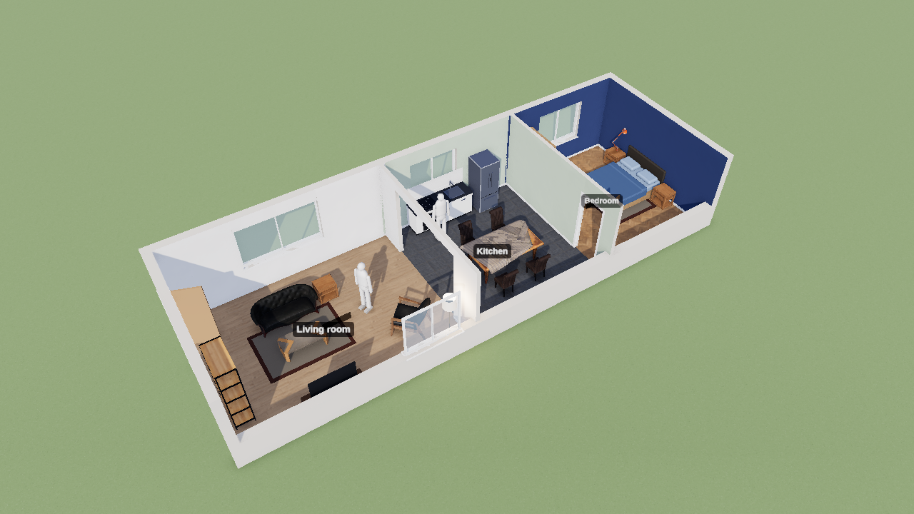
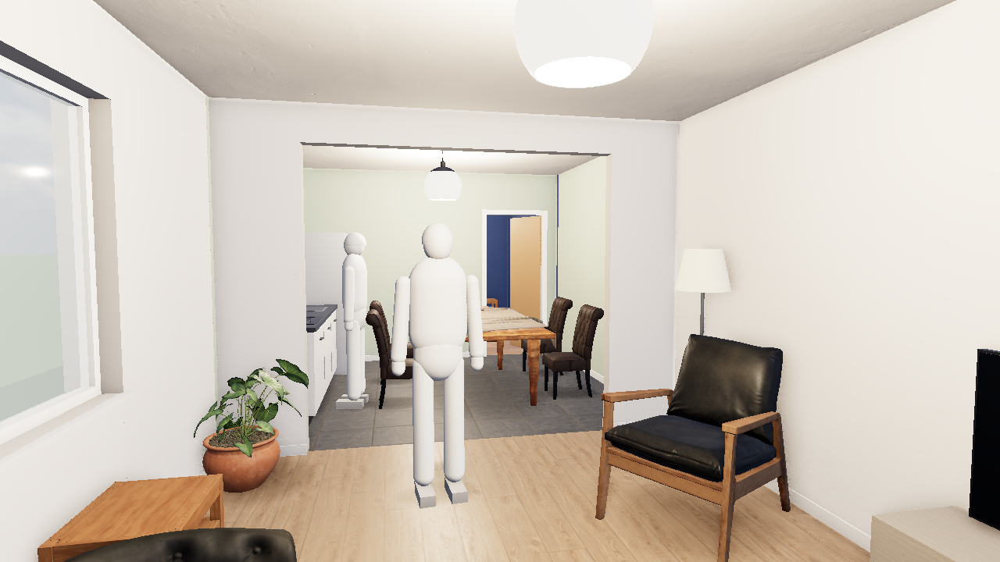
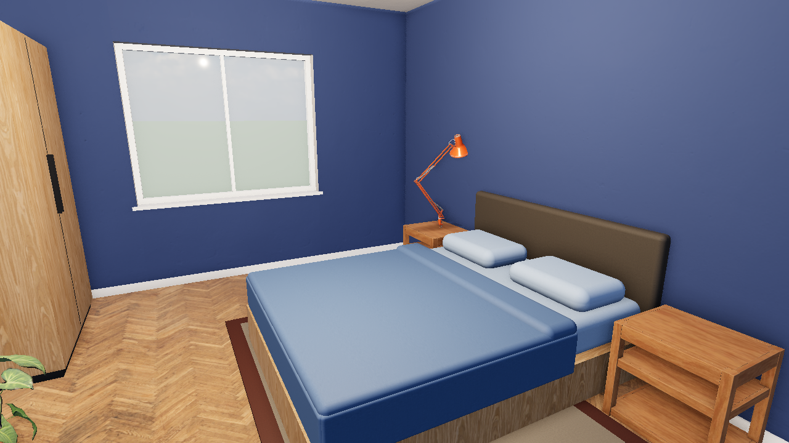

# Stage



An open-source 3D scene engine that AI agents drive and people walk through.
An agent writes one JSON scene file (rooms, doors, windows, furniture,
light) and checks, queries, and renders it from the command line or over
MCP. A person opens the same file in a browser, watches it change as the
agent works, and walks through it at eye level.

The first job it does well: turn a floor plan into a furnished home you can
walk through, to brainstorm what a place could become.

| From the front door | The bedroom |
| --- | --- |
|  |  |

## Install

Stage needs Node 22 or later and Chromium or Chrome for renders.

```sh
npm install
npm run build          # the viewer
bin/stage assets fetch # 40 MB of CC0 textures, models, and sky, into ~/.cache/stage
```

Without `assets fetch`, everything still works: textures fall back to
patterns drawn in code and furniture to pieces built from primitives.

## Use it with an agent

```sh
claude mcp add --scope user stage -- /path/to/stage/bin/stage mcp
bin/stage skill install   # teaches Claude Code and Codex the scene format
```

Then ask: "Start a scene from the flat-with-bedroom example, open it, and
move the sofa under the window." The agent sees every render it asks for;
you see every change in your browser as it lands.

## The scene file

Meters and degrees; plan coordinates `[x, y]` with x east and y north.
Rooms are floor polygons, and walls are built from their edges, shared
where two rooms meet. Openings sit on a room's edge. Items are library
assets placed by their center and turned by `facing` (0 faces north).

```json
{
  "stage": "0.1",
  "name": "One room",
  "levels": [{ "id": "ground", "height": 2.7 }],
  "rooms": [{ "id": "room", "floor": [[0, 0], [4, 0], [4, 3], [0, 3]], "materials": { "floor": "oak-plank" } }],
  "openings": [{ "id": "door", "wall": { "room": "room", "edge": 0 }, "at": 0.5, "type": "door", "width": 0.9, "height": 2.1 }],
  "items": [{ "id": "sofa", "asset": "sofa/three-seat", "room": "room", "at": [2, 2.4], "facing": 180 }]
}
```

Several floors: each level has an `elevation`, a `height`, and a floor
`slab`; rooms stack on their own, a tall room beside a short one gets the
right walls, and `well: true` leaves the hole a stair comes up through.
Stairs are items (`stairs/horseshoe`, `stairs/straight`) that a person
climbs when walking. `open: true` makes a terrace, a roof, or a garden,
with a parapet where nothing else stands. A level can carry a `plan`
image, the architect's drawing, shown under the plan view so the walls can
be checked against it; render `plan:<level>` to see one floor at a time.

`bin/stage schema` prints the whole format as JSON Schema, and
`examples/` has three complete scenes, including a two-storey house.

## Commands

Every command except `open`, `serve`, and `mcp` needs no display, takes
`--json`, exits 0 or 1, and prints errors with the entity and a fix.

| Command | Does |
| --- | --- |
| `stage new <path> [--from flat]` | Start a scene, empty or from an example |
| `stage check <scene>` | Schema, references, and spatial rules |
| `stage render <scene> -o out.png [--camera id] [--level id] [--size 1280x720]` | A deterministic image, through the same page the viewer uses; `plan:<level>` for one floor |
| `stage query <scene> rooms` | Also `room <id>`, `items in <room>`, `walls <room>`, `bounds` |
| `stage set <scene> items '<json>'` | Add an entity, or replace the one with its id |
| `stage remove <scene> <id>` | Remove an entity |
| `stage open <scene>` | The live viewer in your browser |
| `stage show <scene> --focus <id>` | Fly every open viewer to an entity |
| `stage assets [words]` | Search the furniture library |
| `stage assets fetch` | Download the CC0 assets |

## The viewer

**Walk inside** (or `V`) to walk at eye level: `W` `A` `S` `D` and the mouse,
`Shift` to hurry. Walls and furniture stop you. `O` is the overview, `P` the
plan, `C` the next camera, `Q` switches between high quality and fast
rendering, and clicking anything shows its id and size. The page reloads
itself when the viewer is rebuilt, keeping your view.

## Assets and licenses

Textures, furniture models, and the sky come from [Poly Haven](https://polyhaven.com),
all CC0. `assets/lock.json` pins every file by checksum with its source
and real-world size; the files themselves stay in the local cache. A few
models are exported at the wrong scale, so the viewer fits each one to the
real size recorded in `src/core/assets.ts`.

## Development

```sh
npm test               # core: check, geometry, query, formatting, assets
npm run test:render    # headless renders, including determinism
npm run typecheck
```

The code is TypeScript, run directly by Node for the command line and
bundled by Vite for the viewer, which draws with Three.js. See
`src/core` for everything that needs no renderer, `src/viewer` for the
page, and `src/cli` for the commands, the server, and MCP.

## License

MIT. Assets are CC0, from Poly Haven.
